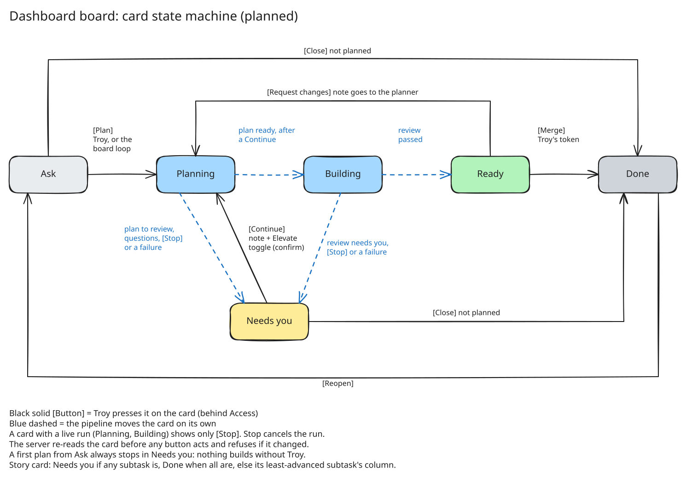

# Dashboard board: cards as a state machine

Decided by Troy, 2026-10-14. The board is built (devkit#98), and so are its
buttons (devkit#99), except Merge, which waits for Troy's merge token. The dashboard's main view is a board of
stories and their subtasks. There is no drag: each card shows only
the buttons its column allows. A button is an action, and the pipeline then
moves the card.



To edit the diagram, open `board.excalidraw.svg` at excalidraw.com, change
it, then _Export image_ → SVG with **Embed scene** on, and overwrite the file.

## Cards

Each column lists its cards by Priority (`P0` first, unset last), then by most
recently updated, so you can work a column top-down. Each card shows its
priority. See docs/pipeline.md for how plans set it.

- **Subtask card:** one issue. It follows the table below.
- **Story card:** a parent issue with sub-issues. It shows its subtasks as
  chips with their columns. Its own column comes from its children:
  - **Needs you** if any open subtask is in Needs you.
  - **Done** when every subtask is Done.
  - Otherwise the column of its least-advanced open subtask.
- A story with no subtasks yet is a plain card. Its plan proposes the
  subtasks, and the pipeline files them as sub-issues in Ask (devkit#12).
  A story itself never builds; each subtask does (docs/pipeline.md).

## Allowed moves

Needs you always goes back to Planning. Planning then decides the next step:
it updates the spec if needed and hands the card to Building, or asks again
and returns it to Needs you. Planning orchestrates; there is no Build button.

| Column    | Buttons                                          | What each button does                                                                                                                                                                                                 | Card goes to |
| --------- | ------------------------------------------------ | --------------------------------------------------------------------------------------------------------------------------------------------------------------------------------------------------------------------- | ------------ |
| Ask       | **Plan**                                         | Adds `agent:plan`.                                                                                                                                                                                                    | Planning     |
| Ask       | **Close**                                        | Closes the issue as not planned.                                                                                                                                                                                      | Done         |
| Planning  | **Stop**                                         | Cancels the live run.                                                                                                                                                                                                 | Needs you    |
| Needs you | **Continue** (optional note, **Elevate** toggle) | Posts a Continue comment with the note, then adds `agent:plan`. Pressing it is Troy's approval to build. With Elevate on, a confirm step comes first, and the build runs elevated on the WSL desk (`agent:elevated`). | Planning     |
| Needs you | **Close**                                        | Closes as not planned.                                                                                                                                                                                                | Done         |
| Building  | **Stop**                                         | Cancels the live run.                                                                                                                                                                                                 | Needs you    |
| Ready     | **Merge**                                        | Merges the PR with Troy's own token, the one used only for merges. Shown disabled ("needs the merge token") until that token exists.                                                                                  | Done         |
| Ready     | **Request changes** (note)                       | A Continue whose note is the change. With no `/revise` yet (devkit#13), the planner takes the note, re-plans and hands back to Building.                                                                              | Planning     |
| Done      | **Reopen**                                       | Reopens the issue.                                                                                                                                                                                                    | Ask          |

What Planning does on each entry:

- **From Ask** (a first plan, which the board loop may start on its own):
  always ends in Needs you, so nothing builds without Troy.
- **From Needs you or Ready** (Troy pressed Continue or Request changes):
  if the plan is ready, it moves straight to Building. If not, it asks and
  returns to Needs you.

The pipeline never merges. **Merge** is Troy's own action, done through his
token, the same as clicking Merge on GitHub.

## How a Continue becomes a build

The buttons act as the pipeline App. Troy's Cloudflare Access login on the
dashboard is the approval (decided 2026-10-14).

1. **Continue** posts an App comment that starts with `<!-- devkit:continue -->`
   (`continue-elevated` with Elevate on), carrying the note. Then it adds
   `agent:plan`.
2. The plan run reads the note like any App comment. When it publishes a plan
   that is ready with no questions, and a Continue made that plan's start, it
   adds `agent:build` (or `agent:elevated`) as the App and moves the card to
   Building. Otherwise it stops in Needs you as before.
3. The admission gate lets the App add `agent:build` and `agent:elevated`.
   The build's render then checks the card's history
   (`bin/agent/approval.ts`): the App's label must come right after a plan
   that a matching Continue started, within a minute of it. So a Continue
   starts one run: a second App label after it is refused, says why on the
   issue and drops the label.

Troy's own labels and commands work as before, with no Continue needed.

## While a run is live

- A card in Planning or Building shows only **Stop**. No button can queue a
  second run behind a live one. The pipeline would queue it, but a silent
  queue looks like a dead button.
- **Stop** cancels the workflow run. The board loop already handles a
  cancelled run: it posts "stopped at `<stage>`" and moves the card to
  Needs you. Stop adds no new path.
- **Close** is hidden while a run is live. Stop first.
- Editing the issue during a run voids the plan. Planning re-checks it on
  the next Continue, so a stale plan never builds.
- A story's buttons act only on the story issue. Its subtasks keep their own
  buttons, so stopping one subtask never stops its siblings.

## Guarding each button

- The server re-reads the card from GitHub before acting and answers 409 if
  the column or the live run changed since the page loaded, or the card no
  longer allows the press. The page then refreshes. A card counts as live in
  Planning or Building, or while it carries a stage label. This covers two tabs, a phone and a desk, or a run that ended
  between the page load and the tap.
- Buttons that start work write the label or comment. The pipeline sets
  Status as it does today. Only Close and Reopen set Status or the
  issue state directly.
- Only Troy, through Cloudflare Access, sees or presses buttons.
- **Stop** finds the run by the issue's title, since an issue event's run is
  named after it. It needs the App's Actions permission (read and write).

## Live updates

The page listens on `/api/events` and refetches when a card or the board
changes. The org webhook (devkit#118) is the only source. GitHub posts every
gingur-root event to `hooks.gingur.com/github`, which cloudflared sends to the
receiver on `127.0.0.1:3001` (`bin/webhooks/receiver.ts`). The receiver
refuses an unsigned post unread, caps the body at 1 MB, checks the
`X-Hub-Signature-256` HMAC against `WEBHOOK_SECRET`, drops a delivery ID it
has already seen, answers 202, then hands the event to each handler. An issue
or comment event names its card; a project item or sub-issue event names the
board.

`dashboard serve` refuses to start without `WEBHOOK_SECRET`. There is no
poller: GitHub does not retry a failed delivery, so a change missed while the
box was down shows on the next reload.

The receiver has no Access app in front of it, so the signature is its only
gate, and it listens on its own port so no dashboard route is reachable
through it. Dedupe lives in memory and forgets on restart; a handler that
starts runs needs a durable store first.

## Events inbox

The receiver also keeps one ordered log of events, whatever sent them, in
`~/.local/state/devkit-dashboard/events.jsonl` (the last 10,000). At each
start, older events move to monthly archives beside it (`events.jsonl.2026-10`),
so nothing is dropped. Every GitHub
delivery lands there as a short summary: `issues.opened`, the repo, the number,
the title and the sender. Any other source posts its own events, and readers
page through the log by id:

```sh
curl -H "Authorization: Bearer $EVENTS_TOKEN" -d '{"type":"paid","data":{}}' https://hooks.gingur.com/events/stripe
curl -H "Authorization: Bearer $EVENTS_TOKEN" 'https://hooks.gingur.com/events?since=0&source=github'
```

Both routes need `EVENTS_TOKEN`. Without it the receiver still records, but
both routes answer 404. The source `github` is reserved for signed deliveries
on `/github`. A redelivery after a failed handler lands twice; the event's
`delivery` id tells the copies apart.
